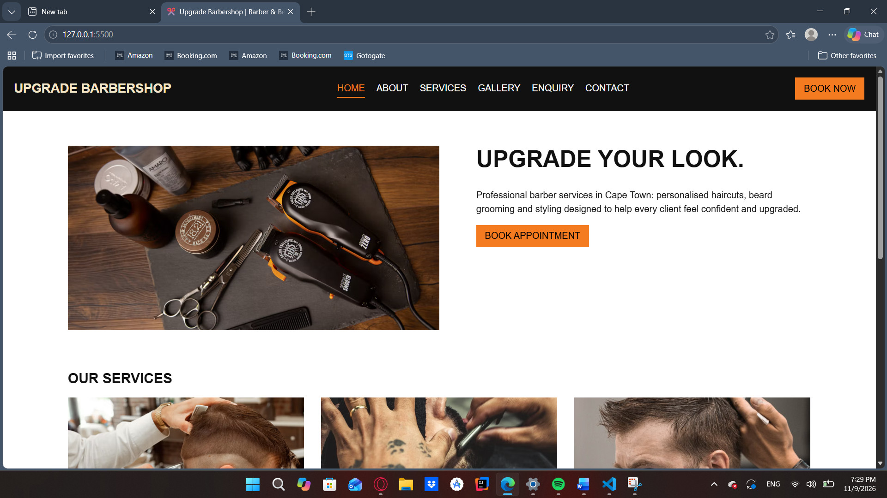
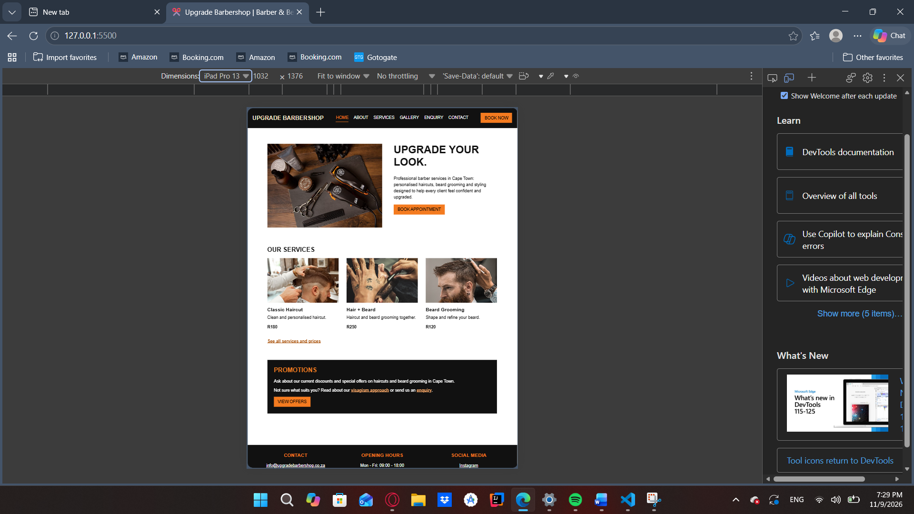
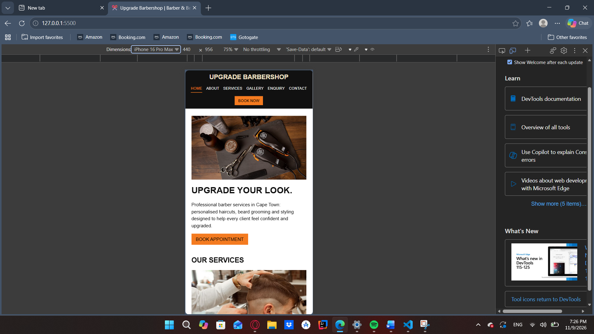

# Upgrade Barbershop Website

# Student Information

**Student Name:** Pedro Henrique Lopes Andrade  
**Student Number:** ST10514330
**Course:** HIGHER CERTIFICATE IN MOBILE APPLICATION AND WEB DEVELOPMENT
**Module:** WED5020  
**Year:** 2026  

## Project Overview

Upgrade Barbershop exists as a contemporary digital platform which was built for establishing a professional image for the enterprise. Experts claim that Upgrade Barbershop serves as a method for providing individuals with details regarding the grooming establishment, various offerings, costs, marketing deals, and ways to communicate. A strong internet presence is established through the features of this Upgrade Barbershop because visibility is necessary for the enterprise.

Many people believe that the creation of Upgrade Barbershop assists clients in gaining knowledge about available hair care activities and submitting booking requests through the internet. The visual layout emphasizes a tidy and current look while this style represents the character of a high-quality grooming center. Professionalism is shown by the aesthetic choices within the Upgrade Barbershop interface so that people feel confident in the services.

Upgrade Barbershop was constructed by developers using HTML5 and CSS3 tools. It has been observed that a straightforward and transparent arrangement remains beneficial for both computer users and mobile device owners. Because the structure is simple, Upgrade Barbershop functions efficiently for all people who seek grooming help across various electronic tools.

## Website Goals and Objectives

The main goals of the website are:

- Create a professional online presence for Upgrade Barbershop.
- Allow customers to view available services and prices.
- Make appointment enquiries easier.
- Provide information about the barbershop and its approach.
- Promote special offers and promotions.
- Provide clear contact and location information.
- Attract new customers while maintaining relationships with existing customers.

### Key Performance Indicators (KPIs)

- Increase online visibility.
- Increase customer enquiries.
- Increase appointment requests.
- Improve access to service and pricing information.
- Provide an easy-to-use customer experience.

## Key Features and Functionality

The website includes:

- Homepage with an introduction to the barbershop.
- About page explaining the barbershop and its philosophy.
- Services page displaying available grooming services and prices.
- Enquiry page for customer enquiries.
- Contact page with appointment and contact information.
- Appointment form with service, date and time selections.
- Promotions section.
- Navigation menu connecting all website pages.
- Responsive layout for smaller screens.
- Images supporting the website content.

## Timeline and Milestones

### Part 1 
Milestone	            Task	                                                                 Completion Date
1	                    Select target organisations and define website concepts	                 17 August 2026
2	                    Research organisations and prepare project proposals	                 17 August 2026
3	                    Plan website structure and create low-fidelity wireframes	             19 August 2026
4	                    Develop website structure using HTML and CSS	                         20 August 2026
5	                    Test website, correct errors and refine the design	                     28 August 2026
6  	                    Final review and submission	                                             1 September 2026

## Part 1 Details

Part 1 includes the project proposal, organisation research, content research and sourcing, sitemap, website structure and initial HTML files.

Parts 2 and 3 will follow in future submissions and will include further development and improvements to the website.

---

## Sitemap

  text
Home
│
├── About
│
├── Services
│
├── Enquiry
│
└── Contact
    └── Booking Form

# References - Part 1 (and css images)

Allegro Digital Team, 2026. How Much Does a Website Cost in South Africa? (2026 Price Guide). Available at: https://www.allegrodigital.co.za/articles/how-much-does-website-cost-south-africa (Accessed: 1 September 2026).

Unsplash, n.d. License. Available at: https://unsplash.com/license (Accessed: 1 September 2026).

Unsplash, n.d. *Barbershop styling photograph.* Available at: https://images.unsplash.com/photo-1534297635766-a262cdcb8ee4 (Accessed: 1 September 2026).

Unsplash, n.d. *Classic haircut photograph.* Available at: https://images.unsplash.com/photo-1593702275687-f8b402bf1fb5 (Accessed: 1 September 2026).

Unsplash, n.d. *Regular haircut photograph.* Available at: https://images.unsplash.com/photo-1622287162716-f311baa1a2b8 (Accessed: 1 September 2026).

Pexels, n.d. *Kids haircut photograph.* Available at: https://images.pexels.com/photos/7697477/pexels-photo-7697477.jpeg (Accessed: 1 September 2026).

Pexels, n.d. *Kids haircut photograph.* Available at: https://images.pexels.com/photos/2062463/pexels-photo-2062463.jpeg (Accessed: 1 September 2026).

Pexels, n.d. *Beard grooming photograph.* Available at: https://images.pexels.com/photos/9992819/pexels-photo-9992819.jpeg (Accessed: 1 September 2026).

Pexels, n.d. *Barbershop interior photograph.* Available at: https://images.pexels.com/photos/17665771/pexels-photo-17665771.jpeg (Accessed: 1 September 2026).

Unsplash, n.d. *Barber machines photograph.* Available at: https://images.unsplash.com/photo-1621605815971-fbc98d665033 (Accessed: 1 September 2026).

Unsplash, n.d. *License.* Available at: https://unsplash.com/license (Accessed: 1 September 2026).

AI Declaration

ChatGPT was used to assist with organising and refining some areas of the project to make the final work more professional. The  decisions, content and implementation were taken and reviewed by the student.

///////////////////////////////////////////////////////////////////////////////////////////////////////////////////////////////

# Part 2 details- 

## Responsive Design Testing

The website was tested on desktop, tablet and mobile screen sizes.
The layout, navigation, images and content were adjusted to remain
clear and usable across different screen sizes.

### Desktop

### Tablet

### Mobile

The website was tested on desktop, tablet and mobile screen sizes.
The layout, navigation, images and content were adjusted to remain
clear and usable across different screen sizes.

## Timeline and Milestones

### Part 2 
Milestone	            Task	                                                                 Completion Date

1	                    Develop website structure using HTML and CSS	                         30 September 2026
2                     Size adjustment across different devices                               2 October 2026
3	                    Test website, correct errors and refine the design	                   3 October 2026
4  	                  Final review and submission	                                           5 October 2026

## Changelog

### Phase 2
- Added responsive CSS for tablet and mobile screens.
- Improved navigation on smaller screens.
- Adjusted images and content widths for smaller devices.
- Tested the website on desktop, tablet and mobile screen sizes.

# References - Part 2 

Unsplash, n.d. License. Available at: https://unsplash.com/license (Accessed: 1 October 2026).

Unsplash, n.d. *Barbershop styling photograph.* Available at: https://images.unsplash.com/photo-1534297635766-a262cdcb8ee4 (Accessed: 2 October 2026).

Unsplash, n.d. *Classic haircut photograph.* Available at: https://images.unsplash.com/photo-1593702275687-f8b402bf1fb5 (Accessed: 2 October 2026).

Unsplash, n.d. *Regular haircut photograph.* Available at: https://images.unsplash.com/photo-1622287162716-f311baa1a2b8 (Accessed: 2 October 2026).

Pexels, n.d. *Kids haircut photograph.* Available at: https://images.pexels.com/photos/7697477/pexels-photo-7697477.jpeg (Accessed: 2 October 2026).

Pexels, n.d. *Kids haircut photograph.* Available at: https://images.pexels.com/photos/2062463/pexels-photo-2062463.jpeg (Accessed: 2 October 2026).

Pexels, n.d. *Beard grooming photograph.* Available at: https://images.pexels.com/photos/9992819/pexels-photo-9992819.jpeg (Accessed: 2 October 2026).

Pexels, n.d. *Barbershop interior photograph.* Available at: https://images.pexels.com/photos/17665771/pexels-photo-17665771.jpeg (Accessed: 2 October 2026).

Unsplash, n.d. *Barber machines photograph.* Available at: https://images.unsplash.com/photo-1621605815971-fbc98d665033 (Accessed: 2 October 2026).

Unsplash, n.d. *License.* Available at: https://unsplash.com/license (Accessed: 2 October 2026).

AI Declaration

ChatGPT was used to assist with organising and refining some areas of the project to make the final work more professional. The  decisions, content and implementation were taken and reviewed by the student.

////////////////////////////////////////////////////////////////////////////////////////////////////////////////////////////////

# Part 3 details

Gallery page with a lightbox (click an image to view it larger).
FAQ accordion on the Enquiry page.
Modal window confirming a booking request.
Interactive Leaflet map of both branches, "Show on map" buttons and a "Find my nearest branch" feature.
Services loaded dynamically with JavaScript, with search, category filter and sorting.
CSS and JavaScript animations and transitions.
Validated forms with error messages, AJAX submission, an instant cost and availability answer (Enquiry) and a compiled email (Contact).
Search engine optimisation (SEO), security and page speed improvements.

## Final sitemap

Home
│
├── About
│
├── Services
│
├── Gallery
│
├── Enquiry
│   └── FAQ
│
└── Contact
    ├── Booking Form
    ├── Message Form
    └── Locations and Map

## Search Engine Optimisation (SEO)

  Keyword research:

KEYWORD:                                             	  USED IN:
barber Cape Town / barbershop Cape Town	                Titles, home hero text, About, meta descriptions
haircut Cape Town	                                      Services title and description, Home
beard grooming Cape Town                                Services, Gallery, meta descriptions
kids haircut Cape Town	                                Services, FAQ
visagism	                                              About, Home promotion, FAQ

On-page SEO: a unique title tag and meta description on every page; one h1 per page with h2 and h3 headings in order; descriptive alt text on all images; clean file names (about.html, services.html, ...); internal links between pages; a viewport meta tag and responsive layout for mobile-friendliness; canonical links; Open Graph and Twitter tags for social sharing.

Local SEO: BarberShop structured data (JSON-LD) with both branch addresses, phone numbers, opening hours and coordinates; clickable phone numbers; Cape Town included in titles and content.

Off-page SEO (done outside the code): see the Deployment section.

robots.txt and sitemap.xml: robots.txt allows crawling and points to sitemap.xml, which lists all six pages.

## Deployment

The website is deployed on Netlify from the GitHub repository, so every push to the main branch updates the live site. The link is: https://upgradebarbershop.netlify.app

## Off-Page SEO and Social Media Promotion

Instagram profile: https://www.instagram.com/upgradebarbershop/

The profile is identified in its bio as a student project for a fictional barbershop.
The website link (https://upgradebarbershop.netlify.app) is placed in the Instagram bio, which gives the site a backlink and a way for visitors to find it.

## Timeline and Milestones
  
Milestone	            Task	                                                                        Completion Date

1	                    gallery page with lightbox	                                                  1 November 2026
2                     created a dynamic services list with search and sort using java script        3 November 2026
3	                    form validation and AJAX submission	                                          7 November 2026
4  	                  added SEO tags, robots.txt and sitemap.xml	                                  8 November 2026
5                     Final README and changelog                                                    9 November 2026

### Changelog

* Interactive elements
- Added reusable JavaScript for animations, modals and accordions.
- Added a 5-question FAQ accordion and a gallery with lightbox navigation.
- Added a Leaflet map with branch markers and nearest-branch search.
- Added CSS animations, transitions and reduced-motion support.

* Dynamic content
- Added JavaScript-powered service cards with search, category filters, sorting and result counts.
- BOOK buttons automatically pre-select services in the booking form.

* Forms
- Improved booking and enquiry forms with HTML5 validation.
- Added client-side validation, error messages, AJAX submission and confirmation modals.
- Added a general contact form linked to the business email.
- Added automatic service selection and pricing.

* SEO, performance and security
- Improved SEO metadata, Open Graph tags, image alt text and internal links.
- Added Local Business structured data, "robots.txt" and "sitemap.xml".
- Optimised images, lazy loading and script loading.
- Added security headers, SRI, honeypot protection and accessibility improvements.
- Updated the README with Part 3 details, changelog and references.

-Added the Instagram profile to the structured data and a social media promotion section to this README.
-Updated this README with the Part 3 information, changelog and references.

# References - Part 3

Agafonkin, V., 2023. Leaflet: an open-source JavaScript library for interactive maps (version 1.9.4). Available at: https://leafletjs.com (Accessed: 3 November 2026).

OpenStreetMap contributors, n.d. OpenStreetMap copyright and license. Available at: https://www.openstreetmap.org/copyright (Accessed: 5 November 2026).

Typicode, n.d. JSONPlaceholder: free fake REST API. Available at: https://jsonplaceholder.typicode.com (Accessed: 5 November 2026).

Google, n.d. Search Engine Optimization (SEO) Starter Guide. Google Search Central. Available at: https://developers.google.com/search/docs/fundamentals/seo-starter-guide (Accessed: 8 November 2026).

Schema.org, n.d. BarberShop. Available at: https://schema.org/BarberShop (Accessed: 8 November 2026).

Mozilla, n.d. MDN Web Docs: Fetch API, IntersectionObserver and Geolocation API. Available at: https://developer.mozilla.org (Accessed: 5 November 2026).

W3C, n.d. WAI-ARIA Authoring Practices Guide: Accordion Pattern. Available at: https://www.w3.org/WAI/ARIA/apg/patterns/accordion/ (Accessed: 5 November 2026).

Netlify, n.d. Netlify Docs: Deploy sites and custom headers. Available at: https://docs.netlify.com (Accessed: 8 November 2026).

AI Declaration

Claude (Anthropic) was used as an additional resource to help refine more complex areas, including the testing API and selected JavaScript elements, improving the overall functionality and professionalism of the project. All main development, decisions and implementation were carried out by the student.
